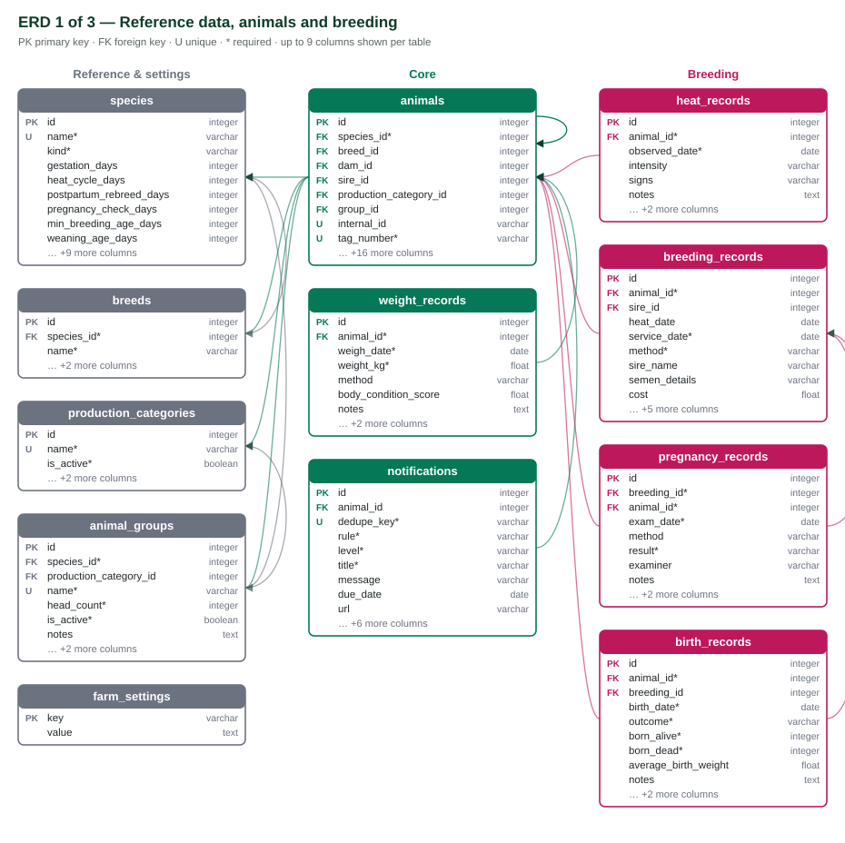
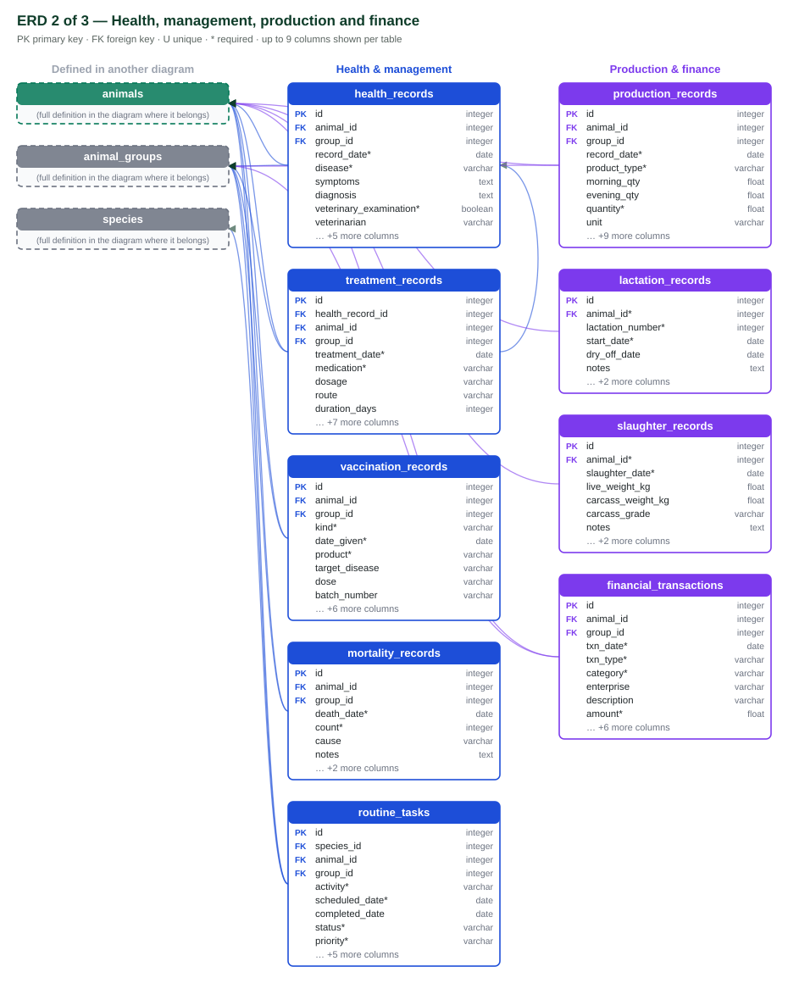
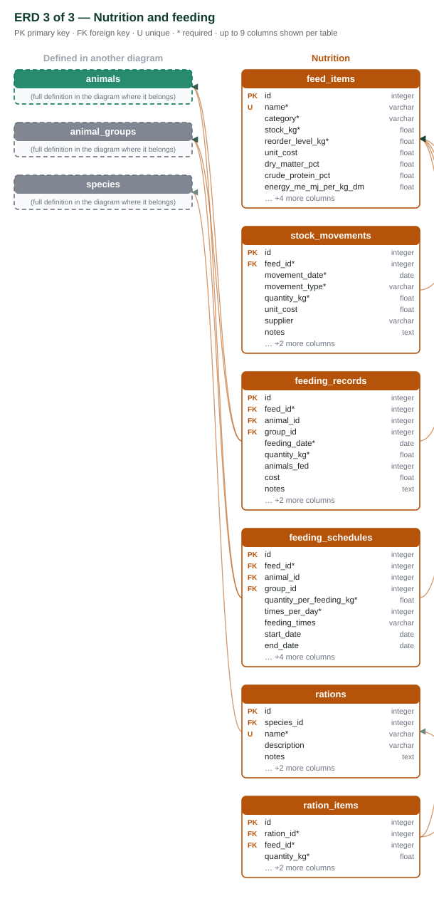
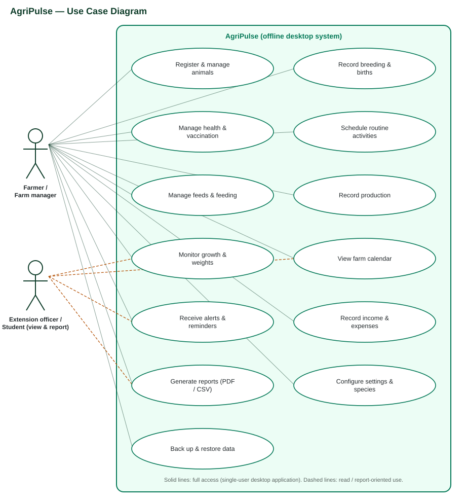
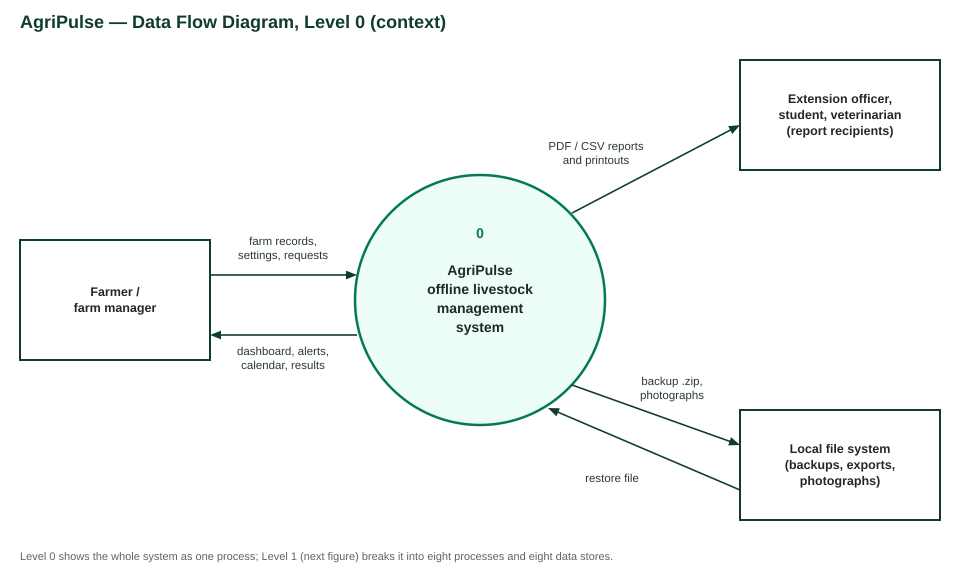
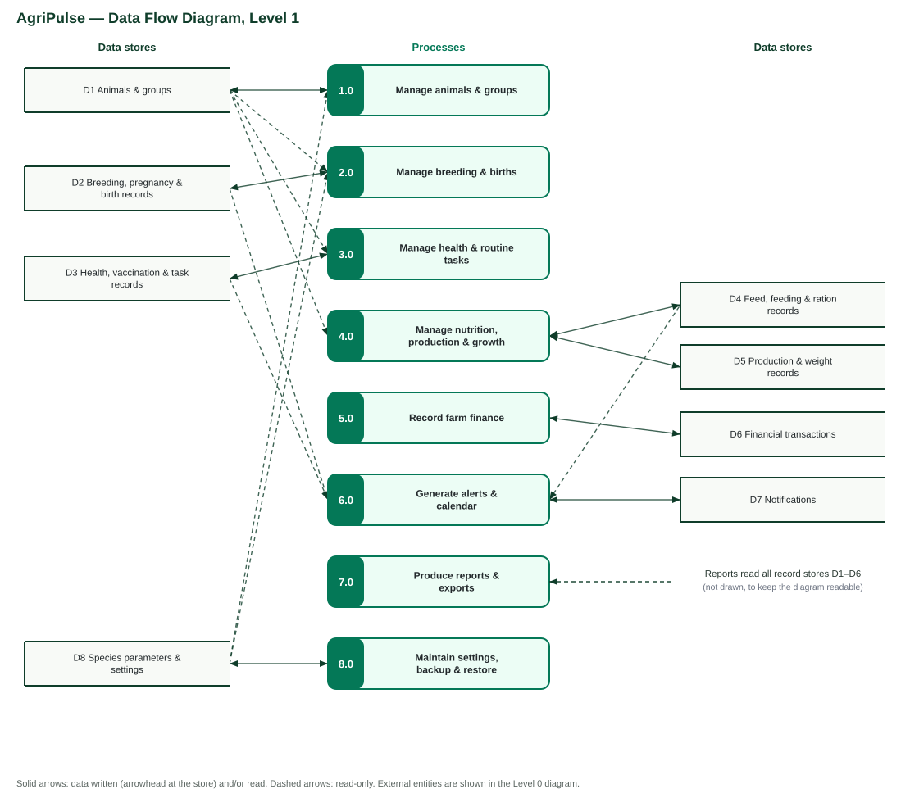
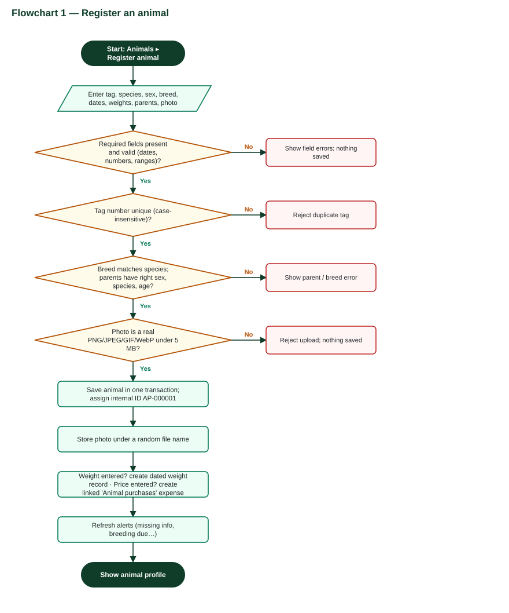
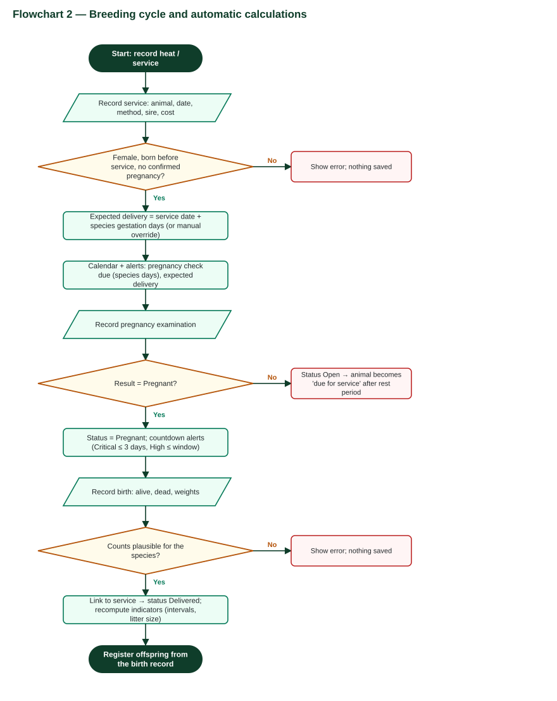
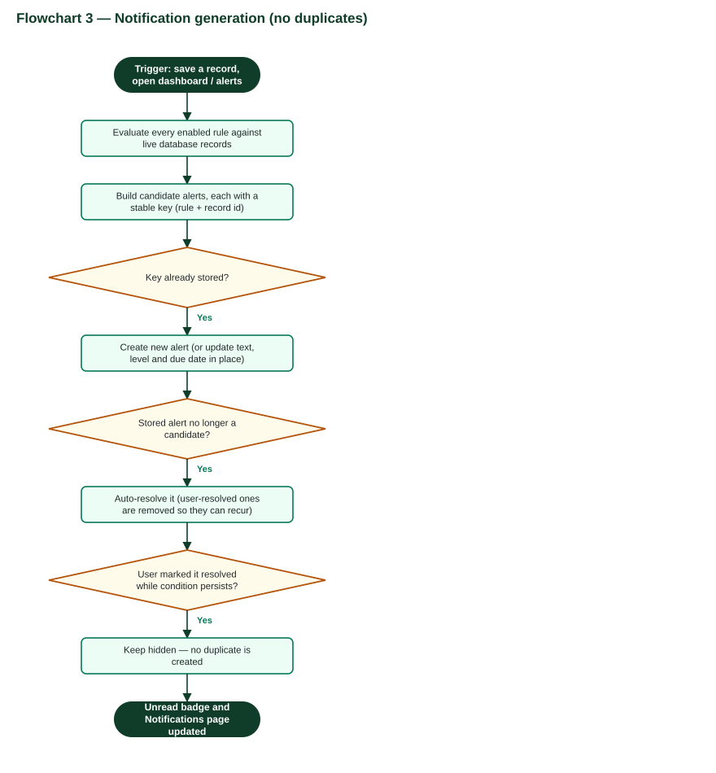
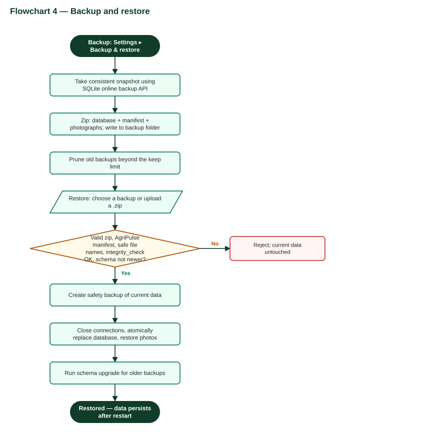

# 1. Project Introduction

**AgriPulse** is an offline-first livestock and farm management information system for Windows 11. A farmer registers animals once, and the system then organises breeding, health, feeding, production, growth, finance and reminders around those records, calculates dates and performance indicators automatically, and shows what needs attention.

The application is a *real, integrated system* rather than a prototype: every module reads and writes one SQLite database, calculations use the recorded data, alerts and the calendar are generated from the live records, and reports export to PDF and CSV. It runs entirely on the farm computer with no internet connection.

| Item | Value |
|---|---|
| Name / tagline | AgriPulse — *Smarter Livestock Management.* |
| Type | Offline desktop application (local web server inside a native window) |
| Stack | Python 3.12, Flask (blueprints, application factory), Flask-SQLAlchemy / SQLAlchemy ORM, SQLite, Waitress, pywebview, HTML5 / CSS3 / vanilla JavaScript, ReportLab (PDF), PyInstaller |
| Species supported | Cattle, dairy goats, meat goats, sheep, pigs, poultry, rabbits, plus any user-defined species |
| Database | 27 tables, 46 foreign keys, versioned schema |
| Size | about 6,300 lines of application Python, 18 templates, 129 lines of CSS, 225 lines of JavaScript, 169 automated tests |

**Design philosophy** (from the project brief), and how it is realised:

1. *Record information once* — a purchase price typed on the animal form, a vet treatment cost, a service fee or a feed purchase automatically appears in Finance; a weight typed on the animal form becomes a dated weight record.
2. *Automatically process and organise records* — expected delivery dates, ADG, conception rate, production percentages and feed conversion are calculated, never typed.
3. *Identify upcoming and overdue activities* — the calendar, dashboard and notification engine are built from real records.
4. *Provide information for decisions* — dashboard indicators, reproductive performance tables, growth flags against species targets, financial summaries.

# 2. Background

Smallholder and commercial livestock farmers in Kenya and similar settings typically keep records in notebooks. Missed vaccinations, forgotten heat dates, undetected late pregnancies and unrecorded costs reduce productivity and profit. Commercial herd software exists but is often cloud-based, subscription-priced, built for temperate dairy systems, and unusable when connectivity is poor. Animal science students and extension officers also lack a transparent system whose calculations they can inspect and explain.

AgriPulse addresses this with an *offline* system whose biological parameters (gestation, cycle length, weaning age, target growth, feed intake) are **visible and editable per species** instead of being hard-coded.

# 3. Problem Statement

1. Manual record keeping is slow, error-prone and hard to summarise.
2. Management activities (vaccination, deworming, pregnancy checks, weaning, hoof trimming) are missed because nothing prompts them.
3. Reproductive dates are calculated by hand, ignoring species differences and leap years.
4. Production, feed and cost data are not linked, so profitability and efficiency are unknown.
5. Existing software is online-only, expensive, or not species-aware.

# 4. General Objective

To design, build and test an offline-first, integrated livestock management information system that lets farmers register animals, maintain complete records, monitor reproduction, health, feeding, production and growth, receive timely reminders and make informed farm decisions.

# 5. Specific Objectives

1. Provide species-aware animal registration with unique identification, parentage, photographs and complete history.
2. Automate reproductive calculations (expected heat, expected delivery, intervals, conception rate) using editable species parameters.
3. Record health events, treatments (without inventing doses), vaccinations, deworming, withdrawal periods and mortality.
4. Schedule routine activities and detect upcoming and overdue work.
5. Manage feed stock, feeding, rations and feed conversion with transparent assumptions.
6. Record milk, egg and other production and calculate summaries and percentages.
7. Track weights and growth against species targets.
8. Generate prioritised, de-duplicated alerts from live data.
9. Record income and expenditure and summarise by month, category and enterprise.
10. Produce PDF and CSV reports, and protect data with backup and restore.
11. Deliver all of this as a standalone Windows desktop program that works without internet.

# 6. Project Justification

* **Practical need** — prevents missed events and shows costs and performance.
* **Offline operation** — works where connectivity is unreliable; the data never leaves the farm computer.
* **Educational value** — modular code, visible formulas and species parameters can be explained and examined by an Animal Science undergraduate.
* **Low cost and maintainability** — free open-source components only, no cloud service, no framework build chain.
* **Data integrity** — relational schema with foreign keys, server-side validation, safe deletion and backups protect farm records.

# 7. Scope

**In scope:** the twelve modules (Dashboard, Animals, Breeding, Health, Routine management, Nutrition, Production, Growth, Calendar, Notifications, Finance, Reports), settings, backup and restore, desktop packaging, tests and documentation.

**Out of scope / not provided** (see Limitations): user accounts and multi-user access, cloud synchronisation, multiple farms in one database, e-mail/SMS delivery of alerts, drug dosing guidance, veterinary diagnosis, accounting (tax, payroll, depreciation), importing from spreadsheets, languages other than English.

# 8. System Requirements

| | Minimum |
|---|---|
| Operating system | Windows 10 / 11, 64-bit (developed and packaged for Windows 11) |
| Runtime (running from source) | Python 3.11 or newer |
| WebView | Microsoft Edge WebView2 Runtime (pre-installed on Windows 11) |
| Memory / disk | 4 GB RAM, about 300 MB for the program, data folder grows with photographs |
| Screen | 1366 × 768 or larger |
| Network | **None** required |

# 9. Functional Requirements

| ID | Requirement | Implemented in |
|---|---|---|
| FR1 | Dashboard with live totals, species/breed/sex/category charts, breeding indicators, upcoming/overdue work, recent health, production and finance | `services/dashboard_service.py`, `routes/main.py` |
| FR2 | Register, view, edit, search, filter, archive, safely delete animals; unique tags; photographs; history | `routes/animals.py`, `services/animal_service.py` |
| FR3 | Heat, service, pregnancy examination, birth records; automatic expected dates and indicators | `routes/breeding.py`, `services/breeding_service.py`, `calculations/reproduction.py` |
| FR4 | Health cases, treatments, vaccination, deworming, withdrawal periods, mortality | `routes/health.py` |
| FR5 | Routine activities with status, priority, reschedule, complete, cancel, repeat; species-specific activity rules | `routes/management.py` |
| FR6 | Feed inventory, stock movements, feeding records, schedules, rations, DMI/CP/ME, FCR | `routes/nutrition.py`, `calculations/nutrition.py` |
| FR7 | Milk, egg and other production; lactations; slaughter/carcass | `routes/production.py`, `calculations/production.py` |
| FR8 | Weight records, ADG, growth history, comparison charts, poor-growth detection | `routes/growth.py`, `calculations/growth.py` |
| FR9 | Interactive calendar (month, week, day) with links to records | `routes/calendar.py`, `services/calendar_service.py` |
| FR10 | Prioritised notifications (Critical, High priority, Upcoming, Overdue, Informational), de-duplicated, read/resolve | `services/notification_service.py`, `routes/notifications.py` |
| FR11 | Income/expense recording, totals, monthly, category and enterprise summaries, filters | `routes/finance.py`, `calculations/finance.py` |
| FR12 | 13 reports with date/species/animal filters; PDF and CSV export; print | `services/report_service.py`, `services/export_service.py` |
| FR13 | Settings: farm, units, date format, currency (KES default), species parameters, breeds, categories, alert rules, backup location | `routes/settings.py` |
| FR14 | Backup and restore with validation and safety copy | `services/backup_service.py` |
| FR15 | Standalone desktop launch and graceful shutdown | `desktop.py` |

# 10. Non-Functional Requirements

| Quality | How it is met |
|---|---|
| **Offline operation** | No external URLs in any page (verified by test); fonts are system fonts; charts are drawn by an in-house canvas library; the server binds to 127.0.0.1 only. |
| **Reliability / integrity** | Foreign keys enforced (`PRAGMA foreign_keys=ON`), unique constraints, one transaction per save with rollback on error, safe deletion, backups. |
| **Security** | CSRF tokens on every POST form, Content-Security-Policy with no inline scripts, upload content verification, path whitelisting, zip-slip protection, formula-injection-safe CSV, secret key generated per installation. |
| **Usability** | Consistent forms with inline error messages, confirmation dialogs for destructive actions, empty states, loading indicators, accessible colour contrast, keyboard focus outlines. |
| **Maintainability** | Application factory, blueprints, services, pure calculation package, declarative forms and generic CRUD engine; the largest source file is 413 lines. |
| **Performance** | Pages render in milliseconds on farm-scale data (hundreds of animals); the full 169-test suite runs in about 80 seconds. |
| **Portability** | Data kept in a per-user folder (`%LOCALAPPDATA%\AgriPulse`), separate from the program, so the program can be updated without touching records. |

# 11. System Architecture

AgriPulse is a layered application. A native window (pywebview) displays pages served by a Flask application running inside a Waitress server on a random local port.

```
 ┌──────────────────────────── desktop.py ────────────────────────────┐
 │  single-instance lock → create_app() → Waitress (127.0.0.1:port)   │
 │                       → pywebview window → on exit: auto-backup    │
 └────────────────────────────────────────────────────────────────────┘
        browser layer          templates + static (HTML/CSS/vanilla JS, canvas charts)
        presentation           routes/  (14 blueprints, one per module) + utilities/crud.py
        business logic         services/ (breeding, calendar, notifications, backup, reports …)
        calculation engine     calculations/ (pure functions, no database access)
        persistence            models/ (SQLAlchemy ORM) → SQLite file in the user data folder
```

**Key design decisions**

* **Application factory** (`create_app`) — creates an isolated application per data folder, which is why the same code runs the desktop program and the automated tests.
* **Blueprints** — `main, animals, breeding, health, management, nutrition, production, growth, calendar, notifications, finance, reports, settings, api` (119 URL rules).
* **Calculation engine separated from storage** — `calculations/` receives plain values (dates, numbers, species parameters) and returns results, so formulas are unit-tested without a database and can be read by a non-programmer.
* **Declarative forms and generic CRUD** — each form is a list of `Field` objects (`utilities/forms.py`); one `CrudSpec` per record type gives validated, CSRF-protected create / edit / delete routes (`utilities/crud.py`). Business rules live in small `validate` / `after_save` hooks.
* **No circular imports** — `extensions.py` holds shared objects; models import nothing from routes; services import models; routes import services.
* **Single source of truth for linked data** — `services/finance_link.py` keeps auto-generated transactions in step with their source record (feed purchase, treatment, vaccination cost, service fee, animal purchase/sale).

**Project layout**

```
AgriPulse/
  app/            models/ routes/ services/ calculations/ utilities/ templates/ static/
  tests/          169 automated tests (+ optional jsdom front-end checks in tests/frontend)
  documentation/  this document, diagrams, user manual, installation guide
  tools/          make_diagrams.py, make_icon.py, build_docs.py, frozen_smoke.py
  config.py  run.py  desktop.py  AgriPulse.spec  build_windows.bat  requirements.txt
```

**Safe schema initialisation.** `utilities/schema.py` creates missing tables (`create_all`), applies numbered migration steps recorded in `farm_settings.schema_version`, then seeds reference data only if the tables are empty. Future schema changes are added as numbered SQL steps so existing users keep their data.

# 12. Database Design

The ORM defines **27 tables and 46 foreign keys**. All tables have an integer primary key and `created_at` / `updated_at` timestamps (except `farm_settings`, a key–value table).

| Group | Tables |
|---|---|
| Reference & settings | `species`, `breeds`, `production_categories`, `animal_groups`, `farm_settings` |
| Core | `animals`, `weight_records`, `notifications` |
| Breeding | `heat_records`, `breeding_records`, `pregnancy_records`, `birth_records` |
| Health & management | `health_records`, `treatment_records`, `vaccination_records` (vaccination **and** deworming), `mortality_records`, `routine_tasks` |
| Nutrition | `feed_items`, `stock_movements`, `feeding_records`, `feeding_schedules`, `rations`, `ration_items` |
| Production & finance | `production_records`, `lactation_records`, `slaughter_records`, `financial_transactions` |

**Integrity features**

* *Primary and foreign keys* with enforcement switched on for every SQLite connection.
* *Unique constraints*: animal tag (case-insensitive `NOCASE` collation), species name, breed per species, one weight per animal per day, one ration ingredient per feed, one notification per `dedupe_key`.
* *Indexes* on every foreign key and on frequently filtered columns (dates, status, species, archived flag).
* *Subject pattern*: records that may belong to an individual animal **or** a group (herd/flock) carry nullable `animal_id` and `group_id`; the forms require exactly one, so every production, feeding, health and finance record is linked to an identifiable animal or group.
* *Derived values are not stored when they can be recomputed*: expected delivery date = service date + the species' current gestation length (a manual override column exists), so editing a species parameter recalculates dates.
* *Safe deletion*: an animal with linked records cannot be deleted (it is archived instead); parents with offspring, feeds with history, species/breeds/categories in use, and groups with data are likewise protected.

# 13. Entity Relationship Diagram

The diagrams below are **generated from the live SQLAlchemy metadata** by `tools/make_diagrams.py`, so they always match the real schema (27 tables, 46 foreign keys). For readability on paper the schema is shown as three diagrams grouped by module; dashed boxes mark tables that are fully defined in another diagram. `PK` primary key, `FK` foreign key, `U` unique, `*` required. A single-sheet version of the whole schema is provided on screen as `documentation/diagrams/erd.svg`.

{width=100%}

{width=100%}

{width=62%}

# 14. Use Case Diagram

The system supports 13 use cases. The **farmer / farm manager** has full access (AgriPulse is a single-user desktop program); **extension officers, students and veterinarians** mainly use the alerts, calendar, growth monitoring and reports, typically while sitting with the farmer or receiving printed or PDF reports.

{width=90%}

# 15. Data Flow Diagram

**Level 0** shows AgriPulse as one process exchanging data with the farmer, report recipients and the local file system (backups, exports, photographs). **Level 1** decomposes it into eight processes and eight data stores that correspond to the real modules and database tables (D1 animals and groups; D2 breeding records; D3 health and task records; D4 feed records; D5 production and weight records; D6 transactions; D7 notifications; D8 species parameters and settings).

{width=90%}

{width=95%}

# 16. System Flowcharts

The flowcharts describe the four most important workflows exactly as implemented: animal registration with its validation chain, the breeding cycle with automatic calculations, notification generation without duplicates, and backup and restore.

{width=100%}

{width=100%}

{width=100%}

{width=100%}

# 17. Implementation Methodology

Development followed an iterative, test-driven sequence applied to the whole system rather than module by module in isolation:

## 17.1 Development sequence

1. Architecture and project structure; configuration with a persistent data directory.
2. Pure calculation engine with unit tests (written first, because every module depends on it).
3. Database models (27 tables), seed data, schema initialisation.
4. Generic form/validation layer and CRUD engine, then each module (animals → breeding → health → management → nutrition → production → growth → finance).
5. Cross-module services (calendar, notifications, dashboard, linked finance, reports, backup).
6. Front end: base layout, macros, offline canvas charts, confirmation dialogs.
7. Desktop shell (Waitress + pywebview) and PyInstaller packaging.
8. Testing and correction (below), then documentation.

## 17.2 Calculation engine and biological assumptions

All formulas are in `app/calculations/` and are unit-tested. Where an assumption is needed it is **configurable and visible** (Settings).

| Calculation | Rule |
|---|---|
| Age | Calendar years / months / days; a 29 February birthday has its anniversary on 28 February in common years. |
| Expected delivery | service date + species gestation days (manual override allowed); leap years handled by calendar arithmetic. |
| Days remaining | expected date − today; **negative = overdue**. |
| Expected next heat | last heat or service + species cycle length; if already past, rolled forward by whole cycles; no prediction if the reference is older than the projection window (default 90 days) or the species has no regular cycle (rabbit, poultry). |
| Intervals | gaps between consecutive distinct service dates / birth dates. |
| Age at first service | first service date − date of birth (unknown or inconsistent data returns "no value", never a misleading number). |
| Conception rate | (Pregnant + Delivered + Aborted) ÷ (those + Open) × 100; services still *Pending* are excluded. |
| Services per conception | services with a known outcome ÷ conceptions. |
| Average daily gain | (weight₂ − weight₁) ÷ days; undefined for same-day or reversed dates. Birth weight is used as the first point of a growth series. |
| Growth performance | ADG compared with the species target: ≥100 % *On/above target*; ≥ threshold (default 70 %) *Slightly below*; below *Poor growth*; negative *Weight loss*. |
| Milk | morning + evening yield; summaries by day, average per recorded day, peak. |
| Egg production % | eggs collected ÷ birds in the flock × 100 (hen-day); eggs cannot exceed birds. |
| Dry matter | as-fed kg × DM %. CP % and ME are on a dry-matter basis. |
| Ration analysis | DM, CP (% of DM), ME density (MJ/kg DM), cost; feeds with missing nutrient data are listed, never silently ignored. |
| Estimated DMI | live weight × species DMI % (planning estimate). |
| FCR | kg feed ÷ kg live-weight gain (only when gain is positive). |
| Financial summaries | income − expenditure; monthly, by category, income by enterprise. |
| Task state | overdue / due today / upcoming / scheduled / completed / cancelled. |

**Default species parameters** (seeded; all editable in *Settings ▸ Species parameters*). They are common textbook planning values, not veterinary advice, and a farmer or advisor should adjust them to the breed and production system.

| Species | Gestation / incubation (d) | Heat cycle (d) | Re-breed wait (d) | Pregnancy check from (d) | Min. breeding age (d) | Weaning (d) | DMI % BW | Target ADG (g/d) |
|---|---|---|---|---|---|---|---|---|
| Cattle | 283 | 21 | 60 | 35 | 450 | 90 | 2.5 | 700 |
| Dairy goat | 150 | 21 | 60 | 45 | 240 | 90 | 3.5 | 100 |
| Meat goat | 150 | 21 | 60 | 45 | 240 | 90 | 3.0 | 100 |
| Sheep | 147 | 17 | 60 | 45 | 270 | 90 | 3.0 | 200 |
| Pig | 114 | 21 | 35 | 28 | 220 | 28 | 3.0 | 650 |
| Poultry | 21 (incubation) | — | — | — | — | — | 5.0 | — |
| Rabbit | 31 | — | 35 | 14 | 150 | 35 | 5.0 | 30 |

Vaccination and deworming intervals are **left blank by default** because correct schedules depend on disease risk, region and product; the farmer (or veterinarian) enters next-due dates. The system **never suggests drug doses**: dosage is stored exactly as the user types it.

## 17.3 Alerts and notification rules

Notifications are *generated from real records* by `services/notification_service.py` and refreshed after every successful save and when alert pages are opened. Each alert has a stable key (rule + record), so it is created once, updated in place while the condition lasts, and auto-resolved when the condition ends. If the user resolves an alert while the condition persists it stays hidden; when the condition ends the stored row is removed so it can reappear later.

| Rule | Level |
|---|---|
| Delivery within window (default 7 days) | **Critical** ≤ 3 days, otherwise **High priority**; **Overdue** if past the expected date |
| Vaccination / deworming due within window (default 7 d) | **High priority** due today or tomorrow, otherwise **Upcoming**; **Overdue** when past |
| Routine task within window (default 3 d) | **Critical / High priority** by task priority or ≤ 1 day, otherwise **Upcoming**; **Overdue** when past |
| Pregnancy examination required (service + species check days passed, no exam) | High priority |
| Animal due for breeding (mature, not pregnant, post-partum wait and cycle elapsed) | Informational |
| Low feed stock (≤ reorder level) / out of stock | High priority / Critical |
| Missing animal information (one summary alert) | Informational |
| Active milk or meat withdrawal period | Informational |
| Weaning due | Upcoming / Overdue |

# 18. Testing Methodology

Testing used four complementary techniques, all executed in the development environment (Linux, Python 3.12):

1. **Unit tests** of the calculation engine (25 tests) — boundary dates, leap years, missing data, impossible values.
2. **Workflow tests through the real HTTP routes** (about 130 tests) — each module is exercised as a user would: submit forms, check the database, check the rendered pages, test both success and failure paths (validation errors, duplicates, forbidden operations).
3. **Infrastructure tests** — start-up and seeding, CSRF enforcement, every POST form carries a token, no external resources, no network calls, foreign keys enforced, persistence across restarts, backup and restore (including corrupt, foreign and malicious archives), Waitress serving on a real socket, the full launcher flow with a stand-in window, graceful shutdown with automatic backup.
4. **Front-end tests** (`tests/frontend`) — the real `app.js` and `charts.js` run against real rendered pages in jsdom: charts draw from data, confirmation dialogs block and release submissions, breed lists follow the species, the breeding preview shows its calculated message, no JavaScript errors on 12 pages.

Additional build checks: PyInstaller (on Linux) built the real `AgriPulse.spec` without errors, and a **frozen smoke-test executable** loaded every page, static file, SQLite and PDF export from *inside* the bundle.

| Test file | Tests | Focus |
|---|---|---|
| test_calculations | 25 | dates, reproduction, growth, production, nutrition, finance, tasks |
| test_startup | 14 | start-up, seeding, security, offline, CSRF coverage |
| test_animals | 19 | registration, duplicates, search, archive, delete, exit, photos |
| test_breeding | 21 | species gestation, pregnancy, births, heat, due-for-service |
| test_health_management | 12 | treatments, withdrawal, vaccination, mortality, tasks |
| test_nutrition | 11 | stock, feeding, rations, FCR, low-stock alerts |
| test_production_growth | 11 | milk, eggs, lactation, carcass, weights, ADG |
| test_notifications_calendar | 14 | alert levels, de-duplication, calendar dates, dashboard |
| test_finance_reports | 12 | finance, all 13 reports, PDF and CSV exports |
| test_settings | 13 | units, formats, species parameters, rules |
| test_backup_restore | 8 | backup, restore, validation, pruning |
| test_desktop_offline | 9 | Waitress, launcher, persistence, no network |
| **Total** | **169** | |

# 19. Results

* **All 169 automated tests pass** (run time about 80 s). All 77 page URLs checked (including every list, form, tab and calendar view) render without errors on an empty database, and all 13 reports render on screen and export to CSV and PDF on a populated database.
* The jsdom front-end checks pass (charts, dialogs, dependent drop-downs, preview).
* The PyInstaller build completes and the frozen executable serves all pages and generates PDFs.
* **Defects found by testing and corrected before completion** (evidence that the tests exercise real behaviour):

| Defect | Found by | Correction |
|---|---|---|
| A Jinja filter chain (`default({}).items()`) crashed every list page with filters | page smoke test | parenthesised expression |
| Ambiguous foreign-key join (service has both `animal_id` and `sire_id`) | page smoke test | explicit join condition |
| A view variable named `chart` shadowed the `chart` template macro | page smoke test | renamed |
| `d.services.values` resolved to the dict method, not the data | page smoke test | renamed key |
| Alert escalation check compared a level with itself (never fired) | code review while writing tests | compare before overwrite |
| Intermittent `OSError: Bad file descriptor` at server shutdown (1 run in 6) | repeated runs of desktop tests | race-free server loop owned by one thread |
| Live "expected delivery" preview never appeared (element missing from the form) | jsdom front-end test | element added; regression test |
| FCR shown with 1 decimal place | nutrition test | 2 decimals |

# 20. Limitations

1. **Windows execution was not performed in the development environment.** The code, tests, PyInstaller build and frozen smoke test were run on Linux. The pywebview window, Microsoft Edge WebView2, native file-save dialogs for downloads, printing and the Windows `.exe` were *not* executed here. Section 23 provides a Windows verification checklist.
2. Single user, no login; anyone with access to the computer can open the data. Operating-system account protection is assumed.
3. One farm per database; no synchronisation between computers.
4. Money is stored as floating-point numbers rounded to two decimals — adequate for farm records, not for formal accounting.
5. Preferred units (kg/lb, litres/gallons) change *display* only; data entry is always metric so records stay consistent.
6. Growth is tracked for individual animals; flock average weights are not supported. Poultry production uses flock (group) records.
7. Default biological parameters are generic planning values; they are not breed- or region-specific and must be reviewed by the farmer or an advisor.
8. Alerts are evaluated when data changes or alert pages are opened; there is no background service that raises a pop-up while the program is idle, and no e-mail/SMS.
9. Calendar projections of heat are estimates from the last observation and the species cycle length.
10. English language only.

# 21. Recommendations

1. Before field use, review *Settings ▸ Species parameters* with a livestock extension officer or veterinarian and adjust them for the local breeds.
2. Enter vaccination and deworming next-due dates from the veterinarian's programme.
3. Use *Herds / flocks* for poultry and pen-based pigs; use individual records for dairy and breeding stock.
4. Keep the automatic backup on exit enabled and copy the backup folder to a USB drive weekly.
5. Complete missing animal information (the alert lists how many animals need it) so reports are accurate.
6. Run the Windows verification checklist after every build.

# 22. Future Improvements

* Optional user accounts and password-protected data.
* Spreadsheet import for existing records and bulk registration.
* Flock average weights and group growth curves.
* Swahili user interface and local-language reports.
* Desktop notifications while the program is idle and optional SMS reminders.
* Pedigree tree and inbreeding coefficient; breed-specific parameter sets.
* Ration optimisation (least-cost formulation) against nutrient requirements.
* Barcode / RFID ear-tag reader support.
* Optional encrypted cloud backup when internet is available.
* Digitally signed Windows installer with automatic updates.
